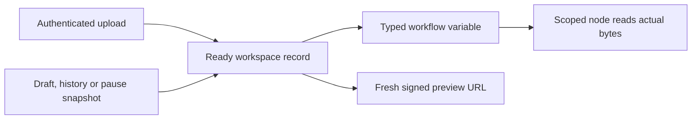

# Runtime files (M2b)

Runtime files reuse the authenticated upload API, local blob store, atomic publication, upload limits and preview signer from protocol 1.17. No storage path supplied in a workflow, request or historical opaque reference is used as a disk path.

## Identity and access

A workflow file is a typed `File` / `Array[File]` value with Dify's `__dify__file__` marker. `reference` and `related_id` identify a ready upload record; `filename`, extension, MIME, size and content come from that record. The optional `id` remains the message-file identity, not an alternate upload lookup key. Historical `dify-file-ref:` references can be read, but their embedded storage paths are ignored.

Console access is scoped to the workspace, matching Dify's account file access. Files are not restricted to their uploader. A foreign workspace, unpublished record, missing blob or changed content cannot be consumed by a node. Blob reads verify the saved length and SHA-256.

The durable record identity and the short-lived preview URL have different lifetimes:

Start inputs, explicit single-step inputs, cached draft values and resumed snapshot pools pass through the scoped adapter. Draft/history/reconnect responses issue fresh links for records that still exist. Deleted files retain their history metadata with an empty link; consuming the missing file fails. A validly signed expired link is refused. An existing authorized record can still obtain a new link.

Remote imports accept HTTP(S), reject embedded credentials and require the configured SSRF proxy. Redirects use the same bounded, proxy-controlled transport. Downloaded bytes are published through the existing atomic upload path. Their persisted contents are reused on later reads instead of fetching a mutable remote URL again.

## Consumers

- Start nodes accept configured single files and lists, including typed empty file lists and `sys.files`. These values remain typed in the variable inspector and single-step cache.
- LLM vision sends actual image bytes and `low` / `high` detail through the model adapter. Inline image variables and the vision selector share one prompt budget. Models without image support retain their text prompts and receive no image part. Saved prompt diagnostics use Dify's truncated image representation, not the full base64 payload.
- HTTP nodes send actual binary bodies and multipart file/list fields. Multipart uses the selected filename, MIME and bytes. Binary responses are persisted as tool files, with an empty text body and typed `files` output; response filenames follow the generated tool-file policy.
- Web human-input forms normalize and validate file answers before persisting them. Refused answers leave the form waiting. A resumed execution resolves the saved file identities again. Single-step human-input forms use the same normalization and file controls.
- Run-result cards and inspector filenames open their signed previews. These controls accept only HTTP(S) links without embedded credentials.

File selection uses the existing `file_selector` integration and authenticated `HttpFilesApi`. Pending uploads disable duplicate attempts. Failure preserves earlier selections; form submission failures also retain the answers and re-enable retry.

## Limits and deliberate boundaries

Deployment upload limits remain authoritative on new uploads and runtime reads. MIME image/audio/video buckets can tighten the extension bucket's limit. A misleading extension cannot borrow a larger limit. Field type, extension and transfer-method restrictions apply before an answer or start input is accepted. The image-specific count also applies inside a mixed file list.

A file list is bounded to 100 entries and 100 MiB of total referenced content, in addition to its configured field count. An image prompt is bounded to 20 MiB before base64 encoding, across all messages and duplicate image references together. HTTP file requests and responses use the configured `collab.httpRequest.maxBinarySize` limit (10 MiB by default). These bounds are per operation; they do not claim to implement workspace storage quotas.

The self-hosted adapter uniformly enforces the configured field transfer methods for images and keeps field restrictions for tool-file references too; it does not copy Dify's tool-file validation bypass. Remote content is frozen to its downloaded record. These are narrower, explicit behaviors.

PDF/Office files can be stored, transmitted and downloaded. Text extraction, OCR, knowledge retrieval, audio/video model prompts and model-generated output files are outside this slice. Public/end-user upload scopes remain a separate phase. Email human-input delivery remains independently disabled; anonymous recipient tokens cannot borrow console files.

## Reproducible verification

Core and route regressions are in `server/Tests/CollabTests/RuntimeFilesTests.swift` and `FileTests.swift`. They cover actual upload storage, record isolation, rejected references, type/count/MIME size limits, prompt bytes and detail, missing storage, binary/multipart payloads, typed empty lists, cached single steps, history links and human-input resume.

`e2e/runtime_files/acceptance.py` exercises real storage, the signed OpenAI-compatible plugin and strict proxy against an isolated fixture. Its model endpoint is a deterministic local capture server, not a paid provider. `browser.py` drives the formal Wasm build's real file chooser, a real HTTP receiver, a refused/retried human form, a new server process over the same database, history and signed preview. It records light/dark and narrow-viewport screenshots; it does not claim physical Android coverage.

These scripts require an existing isolated fixture account and explicit private fixture paths. They must never be pointed at a user deployment. The fixture configuration and authentication files are not evidence attachments and must not be committed.

The port follows fixed Dify 1.17.1 / graphon 0.7.0 file models, file-factory validation, single-step input mapping, HTTP executor, human-input normalization and image prompt conversion. Existing project notices and upstream licenses continue to apply.
