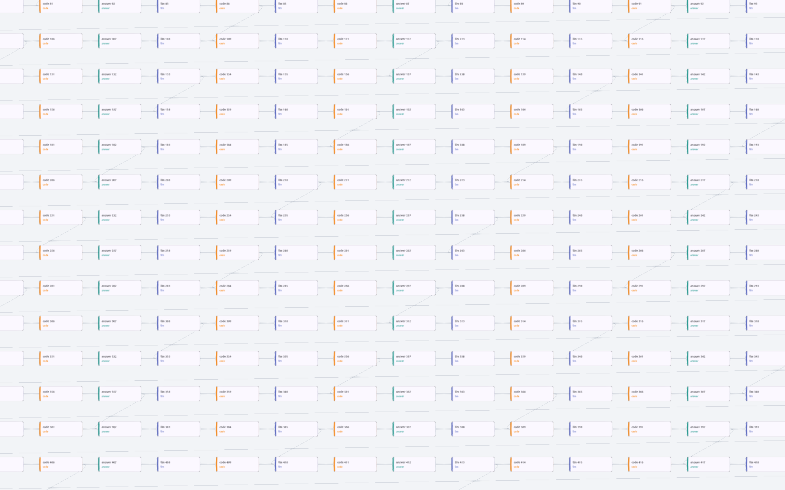

# Canvas spike: Flutter Scene vs widgets, Linux desktop, 120 Hz target

Question: can the workflow canvas reach 120 FPS on Linux at 500 to 2000 nodes, and does Flutter Scene help?
Same graph generator as `app/integration_test/canvas_perf_test.dart` (25-wide grid, chain plus a fan-out every 7 nodes).

## Three canvases, one script

| mode | cards | edges | pan/zoom |
|---|---|---|---|
| `widgets` | widgets, only those in the viewport are built, a RepaintBoundary each | one cached picture (`CustomPaint`) | one layer transform |
| `scene` | `WidgetComponent` per node (Flutter Scene), captured once and again only when the card changes | one GPU-expanded `LineSegmentsGeometry` batch | orthographic camera |
| `hybrid` | widgets, as in `widgets` | Flutter Scene layer under the cards, as in `scene` | both follow the same view |

The script (`lib/main.dart`, `BENCH=true`) runs 4 s per phase: pan (diagonal sweep), zoom (0.4x to 1.6x), edits
(another user renames visible nodes, 20/s; scene mode recaptures those cards), drag (one node in a circle; only its
edges are rebuilt per frame). Then it zooms to 2x and makes text crisp (scene: recapture visible cards at 2x density).
Frame timings come from `FrameTiming`; the interval is the time between consecutive raster finishes.

## Environment

* Headless Weston 14 with the GL renderer on the real GPU (Intel Lunar Lake iGPU), virtual output at 120 Hz;
  `tool/bench.sh` starts it, runs one configuration, takes a compositor screenshot (`SHOOT_AT`), stops it.
* Flutter 3.47.6, profile build, Impeller (OpenGL ES), Flutter GPU on; frames released on the GTK frame clock by the
  vsync driver from raft-flutter (the stock GTK embedder paces at a fixed 60 Hz).
* The empty scene sets the floor this setup can reach: at 1x its p99 interval is already about 11 ms, at 2x it does
  not reach 120 FPS at all (GTK and the compositor copy 4x the pixels). The 9.6 ms p99 acceptance check therefore
  needs a real 120 Hz screen; here the comparison between canvases is what counts.

## Results

Each cell: frames per second and the p99 frame interval in ms (120 Hz = 8.3 ms). Raw output in `results/`.
In this table every scene card holds its texture for the whole run (`CULL=0`); culling follows below.

| 1x (1600x1000) | pan | zoom | edits 20/s | drag | load ms | RSS MB |
|---|---|---|---|---|---|---|
| empty scene (floor) | 122 fps, p99 11.3 | 121 fps, p99 10.7 | 118 fps, p99 11.0 | 119 fps, p99 10.6 | - | - |
| widgets 500 | 116 fps, p99 15.3 | 119 fps, p99 17.3 | 121 fps, p99 12.2 | 119 fps, p99 12.0 | 113 | 213 |
| widgets 1000 | 116 fps, p99 14.5 | 116 fps, p99 15.3 | 120 fps, p99 11.4 | 122 fps, p99 11.5 | 118 | 224 |
| widgets 2000 | 115 fps, p99 14.6 | 118 fps, p99 16.6 | 119 fps, p99 11.7 | 119 fps, p99 12.1 | 119 | 221 |
| scene 500 | 119 fps, p99 14.3 | 120 fps, p99 10.4 | 118 fps, p99 11.0 | 120 fps, p99 11.7 | 339 | 258 |
| scene 1000 | 116 fps, p99 14.2 | 118 fps, p99 10.7 | 118 fps, p99 11.2 | 119 fps, p99 10.4 | 554 | 317 |
| scene 2000 | 120 fps, p99 11.3 | 122 fps, p99 11.1 | 118 fps, p99 10.5 | 120 fps, p99 11.4 | 1014 | 409 |
| hybrid 500 | 115 fps, p99 16.2 | 116 fps, p99 17.1 | 119 fps, p99 11.0 | 120 fps, p99 11.2 | 113 | 215 |
| hybrid 1000 | 120 fps, p99 13.6 | 120 fps, p99 14.3 | 122 fps, p99 11.4 | 118 fps, p99 11.5 | 120 | 217 |
| hybrid 2000 | 115 fps, p99 16.3 | 119 fps, p99 17.4 | 121 fps, p99 11.7 | 120 fps, p99 11.1 | 114 | 220 |
| scene 500, card semantics on | 58 fps, p99 18.7 | 58 fps, p99 18.3 | 101 fps, p99 19.6 | 62 fps, p99 18.4 | 329 | 250 |

| 2x (3200x2000) | pan | zoom | edits 20/s | drag | load ms | RSS MB |
|---|---|---|---|---|---|---|
| empty scene (floor) | 101 fps, p99 21.8 | 106 fps, p99 16.6 | 102 fps, p99 16.8 | 109 fps, p99 16.5 | - | - |
| widgets 500 | 106 fps, p99 22.1 | 110 fps, p99 20.4 | 117 fps, p99 16.0 | 117 fps, p99 16.2 | 114 | 258 |
| widgets 2000 | 107 fps, p99 22.7 | 101 fps, p99 22.5 | 120 fps, p99 13.7 | 113 fps, p99 16.1 | 135 | 261 |
| scene 500 | 102 fps, p99 22.4 | 116 fps, p99 14.4 | 120 fps, p99 13.6 | 122 fps, p99 12.6 | 342 | 279 |
| scene 2000 | 10 fps, p99 289.6 | 72 fps, p99 79.4 | 90 fps, p99 26.3 | 85 fps, p99 23.5 | 2560 | 432 |
| hybrid 500 | 108 fps, p99 22.3 | 114 fps, p99 17.7 | 119 fps, p99 14.1 | 119 fps, p99 13.9 | 120 | 268 |
| hybrid 2000 | 105 fps, p99 22.4 | 112 fps, p99 22.3 | 118 fps, p99 15.5 | 119 fps, p99 14.0 | 115 | 264 |

## Cards in the scene, culled per component

Drawing was already culled by the camera (Flutter Scene's per-frame render work stays around 0.3 ms); what grew with
the node count was that every card held a `WidgetComponent` and its texture. With `CULL=1` (now the default) every
card has a plain placeholder quad, and only cards within half a viewport of the view hold a component and texture;
cards more than a viewport away release theirs, at most 24 captures start per frame, and below 0.3x zoom only
placeholders are drawn. Texture count, load time and memory then follow what is on screen, not the graph size:

| scene cards | pan | zoom | edits 20/s | drag | load ms | RSS MB | cards holding a texture (max) |
|---|---|---|---|---|---|---|---|
| 1x 500, all | 119 fps, p99 14.3 | 120 fps, p99 10.4 | 118 fps, p99 11.0 | 120 fps, p99 11.7 | 339 | 258 | 500 |
| 1x 500, culled | 120 fps, p99 12.2 | 115 fps, p99 14.8 | 121 fps, p99 12.0 | 120 fps, p99 12.5 | 205 | 234 | 320 |
| 1x 1000, all | 116 fps, p99 14.2 | 118 fps, p99 10.7 | 118 fps, p99 11.2 | 119 fps, p99 10.4 | 554 | 317 | 1000 |
| 1x 1000, culled | 120 fps, p99 11.7 | 115 fps, p99 15.4 | 120 fps, p99 12.6 | 120 fps, p99 11.4 | 217 | 230 | 336 |
| 1x 2000, all | 120 fps, p99 11.3 | 122 fps, p99 11.1 | 118 fps, p99 10.5 | 120 fps, p99 11.4 | 1014 | 409 | 2000 |
| 1x 2000, culled | 119 fps, p99 11.4 | 119 fps, p99 12.5 | 119 fps, p99 13.5 | 120 fps, p99 11.5 | 213 | 228 | 336 |
| 2x 500, all | 102 fps, p99 22.4 | 116 fps, p99 14.4 | 120 fps, p99 13.6 | 122 fps, p99 12.6 | 342 | 279 | 500 |
| 2x 500, culled | 104 fps, p99 19.6 | 114 fps, p99 16.8 | 120 fps, p99 14.2 | 98 fps, p99 17.0 | 246 | 273 | 320 |
| 2x 2000, all | 10 fps, p99 289.6 | 72 fps, p99 79.4 | 90 fps, p99 26.3 | 85 fps, p99 23.5 | 2560 | 432 | 2000 |
| 2x 2000, culled | 103 fps, p99 20.4 | 111 fps, p99 17.6 | 120 fps, p99 13.3 | 118 fps, p99 12.6 | 239 | 269 | 336 |

* 2x with 2000 nodes: panning goes from 10 to 103 FPS (the empty scene reaches 101), load from 2.6 s to 0.24 s.
* Load is about 0.2 s at any size; at most about 330 cards hold a texture.
* Cost: zooming out brings many cards into range at once, so zoom p99 rises to about 15 ms at 1x (build p99 5 to 8
  ms); fewer captures per frame or a larger margin before the zoom-out should flatten that.
* One 2x drag run measured 98 FPS; two reruns gave 111 and 114 FPS (the 2x floor is about 109).
* Still to do for a product version: placeholders that carry the node's colour and border (now plain and faint),
  edge width in screen pixels (at 0.25x the 2-unit edges break up).



## Zoomed out: the whole graph on screen

The phases above never go below 0.4x. Panning at 0.25x and 0.15x with 2000 nodes (1x density, `PHASES=pan`,
`HOME_VIEW=3600,1800,<zoom>`; raw output `results/far-*.log`):

| 2000 nodes, pan | 0.25x | 0.15x |
|---|---|---|
| widgets | 51 fps, p99 107.9 (build p99 73.4) | 89 fps, p99 14.5 (raster p99 11.7) |
| hybrid | 29 fps, p99 168.7 (build p99 77.7) | 29 fps, p99 130.7 |
| scene, culled | 120 fps, p99 11.5 | 118 fps, p99 11.2 |

Widget cards break down here: building the cards that pan into view costs up to 73 ms a frame at 0.25x, and at
0.15x painting about 2000 text cards every frame is raster-bound. The scene draws placeholders below 0.3x (no text),
so this is not like for like; widgets could switch to simple boxes too, but that is writing a second renderer, while
culling and level of detail are what Flutter Scene already does.

## Zooming back out: cards ready without loading

Zoomed in to 2x on the middle of the graph (text sharpened), then zoomed out to 0.35x in 1 s, in 0.3 s, or in one
jump (a zoom-to-fit button). `PHASES=zoomback`, `ZB_SEC`; each cell: frames per second and p99 interval over the
2.5 s phase, then the most on-screen cards showing a placeholder at once and how long after the zoom ends they last.

| 1x, 2000 nodes | zoom out in 1 s | in 0.3 s | jump |
|---|---|---|---|
| capture on demand, 24/frame | 97 fps, p99 30.3: placeholders 0 cards, 0 ms | 86 fps, p99 32.5: placeholders 22 cards, 162 ms | 101 fps, p99 23.9: placeholders 208 cards, 417 ms |
| capture on demand, 64/frame | 102 fps, p99 37.9: placeholders 0 cards, 0 ms | 108 fps, p99 31.9: placeholders 0 cards, 0 ms | 104 fps, p99 39.6: placeholders 208 cards, 276 ms |
| overviews, capture only at rest | 121 fps, p99 13.9: placeholders 0 cards, 0 ms | 114 fps, p99 16.4: placeholders 0 cards, 0 ms | 108 fps, p99 16.2: placeholders 0 cards, 0 ms |
| 2x, capture on demand | | | 70 fps, p99 30.8: placeholders 208 cards, 474 ms |
| 2x, overviews | 100 fps, p99 21.7: placeholders 0 cards, 0 ms | | 88 fps, p99 22.2: placeholders 0 cards, 0 ms |

* Capturing cards when they come into view cannot keep up with a fast zoom or a jump (up to 208 placeholders for
  0.3 to 1 s), and the captures themselves cost frames (p99 24 to 40 ms).
* Overviews (`OVERVIEW=1`): every card also gets a half-density capture, taken in the background nearest first, a
  few per frame while the view rests, and kept as its placeholder's texture (a captured texture outlives its
  component). About 5 s for 2000 cards after load (frames at 102 to 114 FPS meanwhile); about 34 MB at 1x, 137 MB at
  2x. At or below 0.5x the overview is the right density, so zooming out needs no capture at all; above it the card
  shows its overview until the full-density capture arrives. No capture or release work runs while the view moves.
* Result: no placeholders at any zoom speed, at 1x and 2x. The remaining slow frames (p99 13.9 to 16.4 ms at 1x)
  are a few frames around the jump; the residency pass still checks all 2000 cards every frame (about 0.5 ms), a
  spatial index would make it follow the on-screen cards.

## Findings (before culling, all cards resident)

1. **All three canvases hold about 120 FPS at 1x up to 2000 nodes.** The app's current canvas (rebuilding the
   positioned cards every frame) was build-bound at 1000 and 2000 nodes (`docs/results/canvas-perf.md`); viewport
   culling plus one layer transform is enough to fix that, with or without Flutter Scene.
2. **Semantics decides whether Flutter Scene works.** The GTK embedder keeps the semantics tree on, and `SceneView`
   updates every hosted card's semantics each frame. With 500 cards about 90% of the UI thread went to
   `_RenderObjectSemantics` (Dart CPU profile, `tool/vmprof.dart`) and the canvas ran at 58 FPS. The cost grows
   faster than the card count and does not depend on what is on screen. Wrapping
   the cards in `ExcludeSemantics` removes the cost; a scene canvas then has to expose its own per-node summary to
   screen readers.
3. **Flutter Scene is smoother on zoom at 1x** (p99 10.4 to 11.1 ms, at the floor) because nothing is built while the
   view changes. The widget canvases build cards that come into view, which shows as zoom/pan p99 of 13.6 to 17.4 ms.
4. **Flutter Scene's cost is memory and texture density.** One texture per card: load 3x to 9x slower, 45 to 190 MB
   more memory at 1x. At 2x density with 2000 cards panning collapsed to 10 FPS (raster p99 290 ms) while the widget
   canvases stayed at the floor. Text is a capture: zooming in shows blurry cards until they are recaptured (22 to
   80 ms for the visible cards). A shipping version needs texture budgeting (only cards near the view keep a texture,
   an atlas, lower density when zoomed out).
5. **Two `WidgetComponent` details:** its default quad is front-facing toward -Z but maps the texture as seen from
   +Z, so cards render mirrored (fixed with an own quad with flipped u); and a manual-capture card must be recaptured
   after it repaints (done from a post-frame callback).
6. **The hybrid costs nothing over widgets** and keeps everything widgets give (semantics, pointer and keyboard input,
   text at screen resolution), while edges, background and future shader or 3D effects live in a Flutter Scene layer.

## Recommendation

Cards in Flutter Scene with per-component culling: they hold up at 2000 nodes, at 2x, and zoomed out to the whole
graph, where widget cards (and the hybrid) break down. Cards, edges and future shader or 3D effects share one renderer. Open items for it:
an accessibility summary per node (cards are excluded from the semantics tree), pointer and keyboard input on cards,
placeholder look before the overviews arrive, edge width in screen pixels, the web build. Final 120 Hz acceptance on a
real 120 Hz screen.

Not covered yet: pointer and keyboard input on scene cards (`WidgetInput.automatic`), text input inside cards, the
web build (the bench entry point uses `dart:io`).

## Running

```
flutter build linux --profile
MODE=scene NODES=2000 SEM=0 tool/bench.sh build/linux/x64/profile/bundle/scene_canvas results/full-scene-2000.log
python3 tool/table.py results
```

Switches (environment): `MODE`, `NODES`, `SEM=0` (cards out of the semantics tree), `EDGES=0`, `CARDS=0`, `AA`,
`PHASES`, `POLICY=every`, `CULL=0`, `OVERVIEW=1`, `OV_BUDGET`, `CAP_BUDGET`, `DENSITY=zoom`, `KEEP`, `PREDICT=1`, `ZB_SEC`, `HOME_VIEW=x,y,scale`; bench: `W`, `H`, `SCALE`, `SHOOT_AT`.
